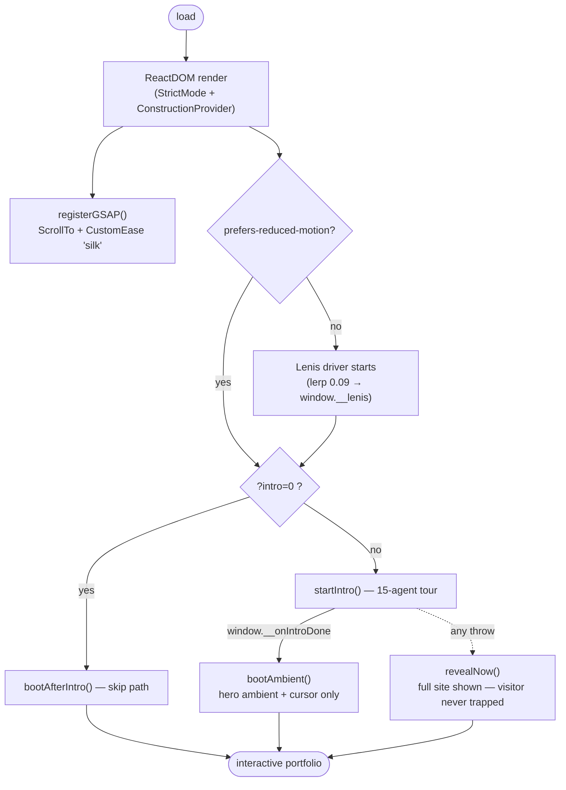
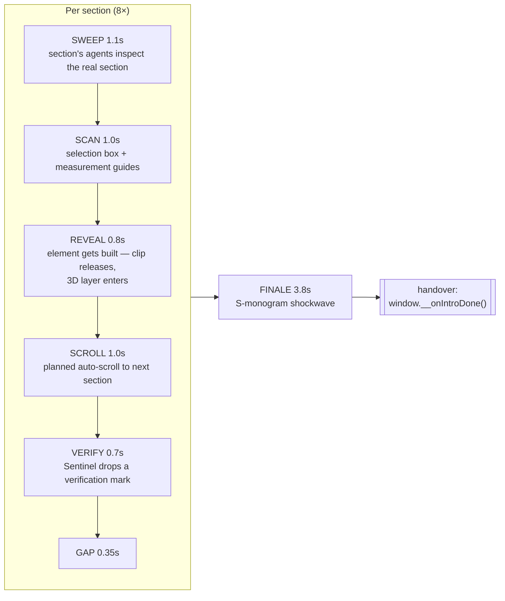
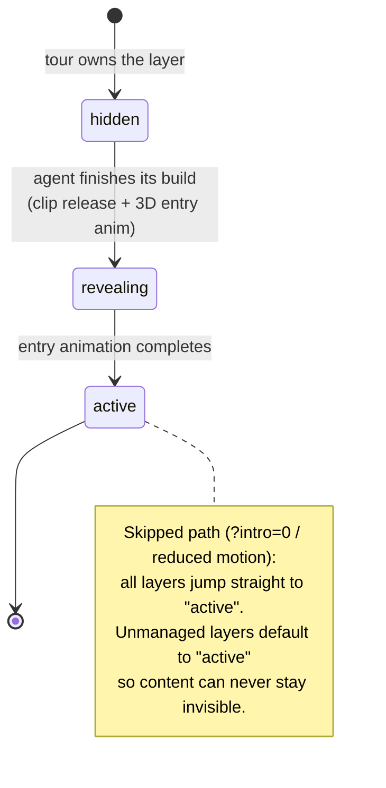
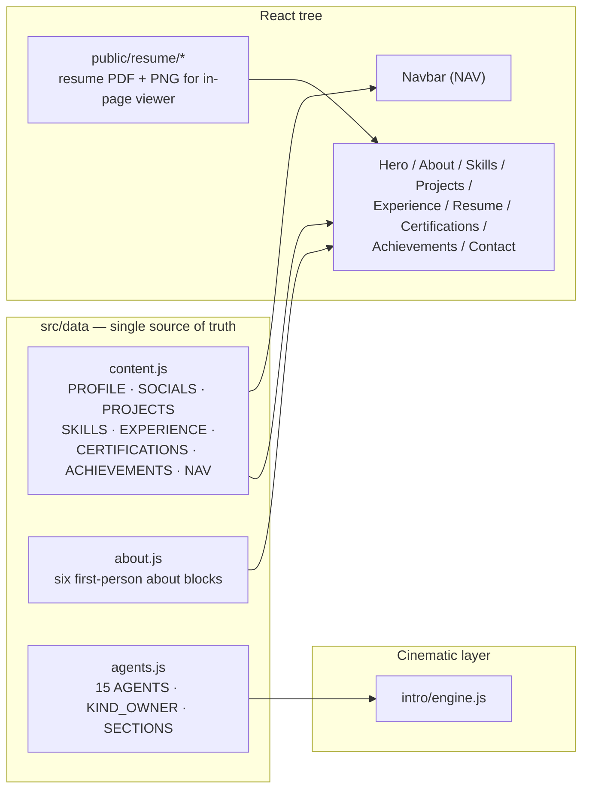

# Architecture — How the Portfolio Works

> Deep documentation for the Shresth Shukla portfolio: the three cooperating systems
> (construction tour, 3D layers, scene motion), their data flow, state machines,
> performance strategy and the runtime API. This file complements
> [`README.md`](../README.md) — the README covers *what*; this covers *how*.

---

## 1. System Overview

The site is one deterministic, single-page experience composed of **three cooperating systems**:

| System | Location | Responsibility |
|---|---|---|
| **Construction tour** | [`src/intro/`](../src/intro/) | A GSAP master timeline that visibly “builds” the real site: opening S-monogram, 15-agent dispatch, per-section sweep/scan/reveal/verify, finale handover |
| **3D layers** | [`src/3d/`](../src/3d/) | React Three Fiber components (cards, timeline, certificate frames, contact card, portrait particles) whose per-layer state is driven by the tour |
| **Scene motion** | [`src/scenes/`](../src/scenes/), [`src/fx/`](../src/fx/) | Post-handover ambient hero motion, scroll-reveal scenes, custom cursor |

All public content (profile, projects, skills, experience, certifications) comes from a
**single source of truth**: [`src/data/content.js`](../src/data/content.js),
[`src/data/about.js`](../src/data/about.js) and
[`src/data/agents.js`](../src/data/agents.js). No component invents facts.

---

## 2. Boot Sequence

Entry: [`src/main.jsx`](../src/main.jsx).



**ASCII definition of the same flow:**

```
load ─► render(StrictMode, ConstructionProvider)
     ─► register GSAP plugins
     ─┬─ reduced-motion / ?intro=0 ─► bootAfterIntro()
     │      • all [data-layer] → "active" (no construction animation)
     │      • initHero() + initSections() + initCursor()
     │
     └─ normal path
            • start Lenis (window.__lenis) — the tour's single scroll driver
            • startIntro()
                 • done  → bootAmbient(): initHeroAmbient() + initCursor()
                 • throw → revealNow()   (hard guarantee: site always usable)
```

Key difference between the two handover paths: on the **skip path** nothing was
constructed, so the full GSAP scroll-reveal scenes run. On the **handover path** the
tour already built every layer — running the reveal scenes would undo the build, so
only the ambient pieces run. Released layers stay released in both cases.

---

## 3. The Construction Tour

Engine: [`src/intro/engine.js`](../src/intro/engine.js) ·
Config: [`src/intro/intro-config.js`](../src/intro/intro-config.js) ·
Agents: [`src/data/agents.js`](../src/data/agents.js) ·
Trails: [`src/intro/trails.js`](../src/intro/trails.js) ·
SFX: [`src/intro/sfx.js`](../src/intro/sfx.js)

### 3.1 Opening sequence (~7.2 s)

| Step | Constant | Duration | What the visitor sees |
|---|---|---:|---|
| S monogram | `S` | 1.0 s | The “S” letterform draws on with concentric rings + glow |
| 3 × agent wave | `waveGap` / `wave` | 0.5 + 1.0 s each | Three five-agent waves fly in on curved paths into orbit |
| Synchronization | `sync` | 1.0 s | Agents slow into circular formation (ring keeps slowly orbiting — never frozen) |
| Hold | `hold` | 2.0 s | Formation hold |
| Dispatch | `dispatch` | 1.0 s | Formation breaks — arrows fly to their first hero targets |
| Fade | `fade` | 0.4 s | S + rings fade as construction begins |

### 3.2 Section build loop

For **each of the 8 constructed sections** (`about → skills → projects → experience →
resume → certifications → achievements → contact`; the hero is inspected first at
dispatch), the tour runs a fixed phase loop:



Per-phase cost ≈ **4.95 s** → tour ≈ **39.6 s** over 8 sections, **≈ 50 s total**
including opening and finale. The tour is **seekable and skippable** — the agent
panel exposes skip/pause/resume, and `window.__intro` exposes the same to tooling.

**Agent-to-layer ownership** (`KIND_OWNER` in `agents.js`): layout → Axis (1),
type → Glyph (4), image → Lens (7), nav → Route (10), button → Press (11),
card → Deck (12), background → Atmos (13), finishing → Polish (14). Grid (2) and
Align (3) drive the measurement/spacing guides; Kern (5), Lead (6), Crop (8),
Frame (9) handle copy, labels, photos and signature frames; **Sentinel (15)**
verifies every completed section.

### 3.3 Architectural guarantees

These invariants are what keep the tour from ever breaking the real site
(detailed in [`INTRO_FIX_REPORT.md`](INTRO_FIX_REPORT.md)):

1. **The overlay is viewport-space, the targets are document-space.** The agent SVG
   overlay is `position: fixed`; agent targets are measured from the real DOM
   (`getBoundingClientRect` + scroll offset) and re-aimed every frame against the
   tour’s *planned* scroll — so flights stay glued to their real elements.
2. **One master timeline, no ScrollTrigger scrub.** A single GSAP timeline drives
   auto-scroll (`ScrollToPlugin`) and every flight, box, guide and reveal.
3. **Zero layout shift.** While `[data-intro=active]` is on `<html>`, every
   `[data-layer]` element is clip-hidden with *inset* (no space is consumed).
4. **Nothing is revealed wholesale.** A layer only appears when its own agent
   finishes it; released layers stay released.
5. **The real page is visible throughout.** The scanning layer works *over* the
   live black + deep-red design, never over an empty background.
6. **Failure ⇒ full site.** `startIntro().catch(revealNow)` — a crashed intro must
   never trap the visitor.

---

## 4. Layer State Machine (3D)

Context: [`src/3d/ConstructionContext.jsx`](../src/3d/ConstructionContext.jsx).
The tour reaches the React tree through `window.__set3DLayerState(layerId, state)`
(bridged in `main.jsx`), and each 3D component subscribes via
`useConstructionState` / `useRawConstructionState`.



- `getLayerState()` **defaults to `active`** — a layer the tour never touched still
  shows.
- `rawLayerState()` returns `undefined` for unmanaged layers, letting premium cards
  stay *truly hidden* until their assigned worker activates them.

---

## 5. The 3D Layer

Components ([`src/3d/components/`](../src/3d/components/)): `ProjectCard3D`,
`SkillTile3D`, `Timeline3D`, `CertificateFrame3D`, `ContactCard3D`,
`Achievement3D`, `Resume3DCard`, `PortraitParticles`.

Hooks ([`src/3d/hooks/`](../src/3d/hooks/)):

| Hook | Job |
|---|---|
| `use3DCard` | Pointer-tracked tilt/parallax for card-style 3D components |
| `usePerformance` | 1 s-window FPS meter; flags `isLowPerformance` below threshold (30 FPS) |
| `useIntersectionPause` | Pauses the R3F render loop while the layer is off-screen |
| `useTabVisibility` | Pauses rendering when the tab is hidden |

Shared scene configuration lives in [`src/3d/config.js`](../src/3d/config.js).
Design notes and implementation history: [`docs/3D_EXPERIENCE_PLAN.md`](3D_EXPERIENCE_PLAN.md),
[`3D_PLAN.md`](3D_PLAN.md) and [`3D_IMPLEMENTATION_REPORT.md`](3D_IMPLEMENTATION_REPORT.md).

---

## 6. Motion & Scroll Architecture

- **Lenis** (`window.__lenis`, lerp 0.09) is the *single scroll driver* during the
  tour — the construction engine stops/starts it as needed. It is created only when
  reduced-motion is off.
- **GSAP scenes** ([`src/scenes/sections.js`](../src/scenes/sections.js)):
  `initHero()` + `initSections()` (skip path) vs `initHeroAmbient()` (handover
  path), all on top of the “silk” custom ease (`M0,0 C0.16,1 0.3,1` — fast commit,
  long graceful settle).
- **Custom cursor** ([`src/fx/cursor.js`](../src/fx/cursor.js)): dot + ring,
  initialized after handover/skip.
- **Signature** ([`src/fx/signature.js`](../src/fx/signature.js),
  [`SignatureAnimation`](../src/components/SignatureAnimation.jsx),
  [`data/signatureStrokes.js`](../src/data/signatureStrokes.js)): stroke-traced
  signature reveal.
- **Shell layers** in [`index.html`](../index.html): grain overlay, cinematic
  letterbox bars, cursor layers.

---

## 7. Content Model



Rule enforced across the project (see
[`docs/FINAL_IMPROVEMENTS_PLAN.md`](FINAL_IMPROVEMENTS_PLAN.md)): when a project has
no deployment, `liveUrl` is `null` and the card says so — **never a fabricated link**.

---

## 8. Performance & Accessibility Strategy

| Concern | Mitigation |
|---|---|
| R3F render cost | `useIntersectionPause` + `useTabVisibility` stop off-screen/hidden render loops; FPS watchdog (`usePerformance`) flags < 30 FPS |
| Layout shift during tour | clip-hidden with *inset* — zero reflow |
| Motion sensitivity | `prefers-reduced-motion` ⇒ skip tour, no Lenis, full content immediately |
| Failure safety | intro `catch` ⇒ `revealNow()`; layer state defaults to `active` |
| Build correctness | Tailwind + Autoprefixer are wired **inside `vite.config.js`** (PostCSS plugins) rather than a standalone `postcss.config.js` — the standalone config mis-resolved through `postcss-import` and stripped every utility class |
| Coarse pointers | Lenis disabled for reduced motion / coarse-pointer environments |

---

## 9. Runtime API (debug / verification surface)

Exposed on `window` by design, consumed by the Playwright suite:

| Handle | Source | Members |
|---|---|---|
| `window.__intro` | `intro/engine.js` | `seek(t)` · `getState()` · `skip()` · `pause()` · `resume()` |
| `window.__lenis` | `main.jsx` | Lenis instance (the tour’s scroll driver) |
| `window.__set3DLayerState` | `main.jsx` bridge → `ConstructionContext` | `setLayerState(layerId, state)` |
| `window.__onIntroDone` | set by `main.jsx` | called by the engine at handover |

---

## 10. Verification

[`scripts/`](../scripts/) holds 30+ single-focus Playwright probes; [`scripts/shots/`](../scripts/shots/)
stores captured evidence (hero at desktop/tablet/mobile, intro frames, projects,
certifications, 3D construction, reduced-motion). Representative:

- `verify-3d-experience.mjs` — audits every `vercel.app` / `render.com` link on the page
- `final-verification.mjs`, `debug-visibility.mjs` — layer-state & visibility audits
- `sync-check.mjs`, `tween-inspector.mjs`, `teardown-check.mjs` — intro timing & teardown
- `motion-check.mjs`, `full-tour-probe.mjs`, `navbar-measure.mjs` — motion/layout checks

Run: `npm install && node scripts/<probe>.mjs`.
Historical logs: [`VERIFICATION.md`](VERIFICATION.md),
[`IMPLEMENTATION_SUMMARY.md`](IMPLEMENTATION_SUMMARY.md),
[`HERO_REDESIGN_PLAN.md`](HERO_REDESIGN_PLAN.md),
[`INTRO_FIX_REPORT.md`](INTRO_FIX_REPORT.md),
[`RESUME_IMPLEMENTATION_REPORT.md`](../RESUME_IMPLEMENTATION_REPORT.md).

---

## 11. Key Design Decisions (log)

| Decision | Rationale | Where documented |
|---|---|---|
| Build the *real* DOM, not a fake splash | The tour is a demonstration of the site itself; every reveal is a real layer state change | `INTRO_FIX_REPORT.md` |
| One master timeline instead of ScrollTrigger scrub | Deterministic, seekable, verifiable; no scroll-position coupling mid-tour | `INTRO_FIX_REPORT.md` |
| Lenis as the tour’s single scroll driver | Auto-scroll and user-perceived motion share one driver; the engine can stop/start it | `main.jsx` |
| 15 distinct agents, colour *never* the only cue | Accessibility + legibility: each agent has its own trail style, chip and idle motion | `agents.js` |
| `active` default for layer state | Content must never remain invisible if the tour doesn’t run (SEO, skip path, failures) | `ConstructionContext.jsx` |
| Tailwind inside `vite.config.js` | Standalone PostCSS config choked on the tailwind plugin and removed all utility classes | `vite.config.js` |
